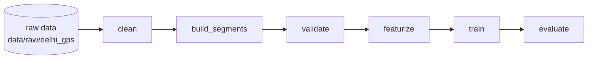

# AI-Assisted Public Transport Information System - Delhi Bus Travel-Time Prediction

Predicts stop-to-stop travel time for Delhi buses (routes 425/534) from
real-time GPS node-crossing data, versioned and tracked end-to-end with DVC
and Weights & Biases. The best model (tuned LightGBM, L1 objective) reaches
a test MAE of **30.60 seconds**, a 19.93% improvement over the best non-ML
baseline - beating the 10% success target.

> The earlier TTC (Toronto) bus-delay version of this project is preserved
> at git tag `ttc-final` (branch `archive/ttc-version`).

## Pipeline (DVC)



Stages exactly as in `dvc.yaml`: `clean` → `build_segments` → `validate` →
`featurize` → `train` → `evaluate`.

## Tools

| Tool | Role |
|---|---|
| Git / GitHub | Version control, code history, collaboration |
| uv | Python dependency and environment management |
| DVC + DagsHub | Data/pipeline versioning, remote storage, pipeline DAG |
| Pandera | Schema/data validation gate inside the pipeline |
| Weights & Biases | Experiment tracking, model/dataset artifacts and lineage, Bayesian hyperparameter sweeps |
| LightGBM / scikit-learn | Model training (gradient boosting, ridge, random forest, baselines) |
| PyTest | Unit tests, incl. leakage guards for the recent-bus features |
| Jupyter | Exploratory data analysis |

## Results

| Model | Validation MAE (s) | Test MAE (s) |
|---|---:|---:|
| global_median | 68.56 | 71.13 |
| typical_baseline | 38.00 | 41.29 |
| recent_buses_baseline | 37.73 | 38.22 |
| ridge | 37.51 | 49.67 |
| random_forest | 30.30 | 31.78 |
| lightgbm_l2 | 29.84 | 31.30 |
| **lightgbm_l1 (best)** | **29.33** | **30.60** |

Target: ≥10% test MAE improvement over the best non-ML baseline
(`recent_buses_baseline`). **Actual: 19.93% - met.** Full write-up in
`docs/model_evaluation.md`.

## How to reproduce

```bash
git clone https://github.com/niksi-nova/mlops.git
cd mlops
uv sync

# DVC remote credentials (DagsHub) - keep these local, never commit them
dvc remote modify origin --local access_key_id <your-dagshub-token>
dvc remote modify origin --local secret_access_key <your-dagshub-token>

uv run wandb login

uv run dvc pull        # pull data/model artifacts from the DVC remote
uv run dvc repro       # run the full pipeline (skips up-to-date stages)
uv run pytest -q       # run the test suite
```

To run the LightGBM hyperparameter sweep (optional, not run automatically):

```bash
uv run wandb sweep sweeps/lightgbm_l1_sweep.yaml
uv run wandb agent <sweep_id>
```

## Links

- GitHub: https://github.com/niksi-nova/mlops
- DagsHub (DVC remote): https://dagshub.com/niksi-nova/mlops
- W&B project: https://forge.coreweave.com/wandb/anikaub20-rv-college/delhi-bus-delay
- Docs: [`docs/`](docs/) - `dataset_card.md`, `data_inventory.md`,
  `eda_findings.md`, `project_overview.md`, `model_evaluation.md`

## Repo layout

```
src/
  data/        ingest, clean, build_segments, validate
  features/    time features, build_features (featurize stage)
  models/      tracking (W&B), baselines, train, sweep_train, evaluate
notebooks/     EDA notebook
scripts/       raw-data inspection
sweeps/        W&B sweep config
tests/         unit tests (incl. leakage guards)
docs/          dataset card, data inventory, EDA findings, overview, evaluation
reports/       pipeline metrics + figures
params.yaml    all stage parameters
dvc.yaml       pipeline definition
```

## Team

Anika, Ajay, Asrith, Aditya
