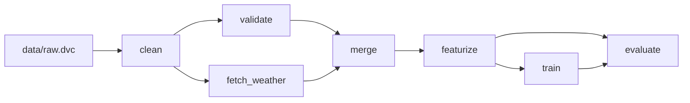

# TTC Bus Delay Prediction

An end-to-end MLOps pipeline that predicts how many minutes a reported TTC
bus disruption will last, from historical delay, weather and calendar data.
The best model (LightGBM, L1 objective) reaches a test MAE of **8.30
minutes** (median error 3.00 minutes) on 2024 data — a 6.75% improvement
over the route × incident naive baseline, short of the 15% target set for
this phase.

## Pipeline

The DVC pipeline (`dvc.yaml`) runs as a single DAG from raw data to the
final test evaluation:



- **clean** — standardises the raw TTC workbooks into one tidy table (`src/data/clean.py`)
- **validate** — pandera schema checks on the cleaned table; fails the pipeline on bad data (`src/data/validate.py`)
- **fetch_weather** — pulls hourly Toronto weather from Open-Meteo for the cleaned data's date range (`src/data/fetch_weather.py`)
- **merge** — joins each incident to the weather at its hour (`src/data/merge.py`)
- **featurize** — time-based train/val/test split, time/holiday/weather features, smoothed target encoding (`src/features/build_features.py`)
- **train** — trains and compares 6 models, logs every run to MLflow (`src/models/train.py`)
- **evaluate** — final evaluation on the held-out 2024 test split (`src/models/evaluate.py`)

## Tools

| Tool | Role in this project |
|---|---|
| Git / GitHub | Version control and collaboration for all code and docs |
| [uv](https://docs.astral.sh/uv/) | Dependency management, lockfile, and the runner for every script (`uv run ...`) |
| [DVC](https://dvc.org/) + [DagsHub](https://dagshub.com/) | Versions the raw data and defines/runs the pipeline DAG (`dvc.yaml`); DagsHub hosts the DVC remote |
| [Pandera](https://pandera.readthedocs.io/) | Schema validation on the cleaned data, gating the pipeline before weather/merge/featurize run on bad data |
| [MLflow](https://mlflow.org/) (via DagsHub) | Experiment tracking for every training run, hyperparameter sweep and the final evaluation |
| [LightGBM](https://lightgbm.readthedocs.io/) / [scikit-learn](https://scikit-learn.org/) | The model family (naive/median baselines, Ridge, Random Forest, LightGBM L2/L1) |
| [PyTest](https://pytest.org/) | Unit tests for every pipeline stage's core logic (cleaning, features, training, tracking, evaluation) |

## Results

All 6 models, trained on data through 2022, validated on 2023, tested on 2024:

| Model | Validation MAE | Test MAE |
|---|---|---|
| naive_baseline (route × incident) | 8.114 | 8.903 |
| global_median | 9.773 | 10.413 |
| ridge | 8.153 | 8.947 |
| random_forest | 7.924 | 8.644 |
| lightgbm | 7.871 | 8.607 |
| **lightgbm_l1 (best)** | **7.408** | **8.302** |

**Target verdict:** the goal was ≥15% test MAE improvement over the naive
baseline. The best model achieves **6.75%** — **target not met**. It does
beat the simpler global-median baseline by **20.27%**. See
[`docs/model_evaluation.md`](docs/model_evaluation.md) for the full error
analysis and an honest discussion of why.

## How to reproduce

```bash
git clone https://github.com/niksi-nova/mlops.git
cd mlops
uv sync

# DVC remote (DagsHub) credentials — stored locally, never committed
dvc remote modify origin --local access_key_id <your-dagshub-token>
dvc remote modify origin --local secret_access_key <your-dagshub-token>

# MLflow tracking — create a .env with:
#   MLFLOW_TRACKING_URI=https://dagshub.com/niksi-nova/mlops.mlflow
#   MLFLOW_TRACKING_USERNAME=<your-dagshub-username>
#   MLFLOW_TRACKING_PASSWORD=<your-dagshub-token>

uv run dvc pull      # fetch versioned data/models from the DVC remote
uv run dvc repro     # run (or re-run) the full pipeline
uv run pytest        # run the test suite
```

Always use `uv run dvc ...` (not a bare `dvc` command) so DVC runs inside
the project's locked environment.

## Links

- DagsHub repo: https://dagshub.com/niksi-nova/mlops
- MLflow experiments: https://dagshub.com/niksi-nova/mlops.mlflow
- Docs:
  - [`docs/dataset_card.md`](docs/dataset_card.md) — dataset card for the TTC delay data
  - [`docs/data_inventory.md`](docs/data_inventory.md) — raw file/sheet/column inventory
  - [`docs/eda_findings.md`](docs/eda_findings.md) — EDA findings and feature-engineering decisions
  - [`docs/model_evaluation.md`](docs/model_evaluation.md) — final test evaluation and error analysis
  - [`docs/project_overview.md`](docs/project_overview.md) — problem, objectives, risk assessment, Phase 1 results

## Repository structure

```
mlops/
├── data/              # raw / interim / external / processed (DVC-tracked, not git)
├── docs/              # dataset card, data inventory, EDA, evaluation, project overview
├── models/            # trained models, model_index.json (DVC-tracked, not git)
├── notebooks/         # 01_eda.ipynb
├── params.yaml        # all pipeline parameters
├── dvc.yaml / dvc.lock
├── reports/           # metrics JSON + figures for every stage
├── scripts/           # one-off inspection scripts
├── src/
│   ├── data/          # clean, validate, fetch_weather, merge
│   ├── features/      # time_features, build_features
│   └── models/        # train, tune_lightgbm, evaluate, tracking
└── tests/             # pytest suite, one file per module
```

## Team

Anika · Ajay · Asrith · Aditya
